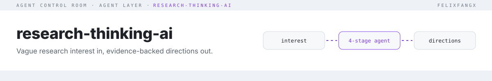
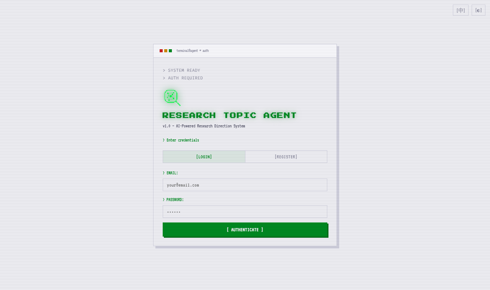

<picture>
  <source media="(prefers-color-scheme: dark)" srcset="./docs/assets/header-dark.svg">
  
</picture>

**An agent pipeline that turns a vague research interest into ranked, evidence-tiered research directions and a 7-day action plan.** [Live demo](https://research.ledring.dev) · English | [中文文档](./README.zh-CN.md)

[](https://research.ledring.dev)

## Quickstart

```bash
git clone https://github.com/FelixFangX/research-thinking-ai.git
cd research-thinking-ai && pnpm install
cp .env.example .env.local   # optional; pnpm dev needs no environment variables
pnpm dev                     # http://localhost:5173
```

`pnpm dev` works without any environment variables. Live evidence and the free model need the Worker: use `pnpm build && npx wrangler@3 dev` locally, or deploy as described below. A **mock preview** is also available; configure your own key under Settings → Advanced for direct provider calls.

The legacy `supabase/` folder is no longer used by the web app; it is kept for reference until it is retired.

## Trace export (LEDRING)

Use **Download trace** on a finished result or history item to save a validated `ledring.trace.v1` run. It includes stage choices, evidence titles and ids, the selected path, and recorded timing, model usage and citation statuses where available. Older records may lack this metadata. Full prompts, credentials and user ids are excluded; runs stay in your browser.

`POST /api/trace` converts a finished session record (directly or as `{ "record": ... }`, JSON, up to 256 KB) into a trace download. `GET /api/trace/sample` serves a fixed deterministic demo. Both endpoints use no AI, reserve no LLM quota and store no runs.

```bash
curl -s https://research.ledring.dev/api/trace/sample -o sample.ledring.json
curl -s https://research.ledring.dev/api/trace -H 'Content-Type: application/json' --data-binary @record.json -o run.ledring.json
ledring flowchart sample.ledring.json
ledring instability sample.ledring.json
```


## Cloudflare demo (preview)

Try https://research.ledring.dev — no sign-up required. The free Workers AI model is **GLM-4.7 Flash**, with **Gemma 4 26B** selectable. Live citations come from OpenAlex with Crossref fallback. Evidence caching on the custom domain uses the Workers Cache API and is per-datacenter and best-effort.

Shared daily caps reset at midnight UTC: **8,000 neurons/day globally** and **600/day per IP**, with **12 LLM requests/minute per IP**. A full run measured about **115 neurons**; usage varies by input and output (see the eval below).

Bring your own key under **Settings → Advanced**: calls go directly from the browser to the provider and never touch the Worker. There are no third-party requests on page load, fonts are self-hosted, and analytics is off by default.

## Usage

1. Describe the interest, domain, seed idea and constraints.
2. Pick a participation mode: **HIGH** (confirm each stage) or **LOW** (auto, override afterwards).
3. Follow the four stages as they stream: Retrieval → Landscape → Path comparison → Convergence.
4. Export the report or keep iterating. History stays in IndexedDB.

LLM: OpenAI or Anthropic, or any OpenAI-compatible base URL (DeepSeek, Moonshot, local). With "Remember key" on, the key is AES-GCM encrypted in the browser.

## How it works

```text
TopicInput ─▶ assessComplexity ─▶ decideArchitecture ─▶ 4-stage pipeline ─▶ AgentRunResult
                 (score 12–95)      single_agent │ workflow_orchestrator │
                                    multi_agent │ rag_workflow │ kg_orchestrated
                                                         │
                                                  streamLLM (SSE) ── OpenAI / Anthropic / mock
```

| Seam | Where | What's tested |
|---|---|---|
| LLM output → data | `parseJSON` in `src/llm.ts` | plain, fenced, embedded JSON; rejects garbage and oversized input |
| Routing | `assessComplexity` + `decideArchitecture` in `src/engine.ts` | topic → architecture mode, score bounds, rationale |
| Stage schemas | `parseStage` in `src/schemas.ts` (zod) | coercion, errors name the stage and field |
| Headless run | `runResearch` in `src/headless.ts` | full pipeline without UI, injectable evidence/LLM |
| Citation check | `checkCitations` in `src/citations.ts` | verified / title-mismatch / not-found / broken / search-link |

Evidence is tiered T1/T2/T3 and conflicts are flagged before convergence. More detail: [`docs/SYSTEM_ARCHITECTURE.md`](./docs/SYSTEM_ARCHITECTURE.md).

## For agents (MCP) and weekly watch

```bash
pnpm mcp      # stdio MCP server: propose_directions(interest, domain?, evidence?) and expand(direction, interest)
pnpm watch --json                          # "what changed" notes in watch/out/ (OpenAlex only)
pnpm watch --digest-dir <daily/> --json    # also use a local digest checkout
```

MCP client config: `{"command": "pnpm", "args": ["--dir", "/abs/path/research-thinking-ai", "-s", "mcp"]}`. Both tools are read-only. Evidence comes from OpenAlex, and every citation carries its check result (`verified`, `not-found`, `broken`, `search-link`). Without `LLM_API_KEY` in the server's env the four stages run the deterministic engine, so directions are generic templates around real evidence. Set `LLM_API_KEY` (plus `LLM_BASE_URL`/`LLM_MODEL`) for model-written directions.

The weekly watch (`.github/workflows/weekly-watch.yml`, Mondays) runs each topic in [`watch/topics.json`](./watch/topics.json) using OpenAlex, plus the last 7 days of `digest.json` when a digest source is available. The digest repo is private, so CI runs OpenAlex-only unless the `DIGEST_URL` repo variable points at a public copy. Each note and `status.json` record the digest as `off`, `unavailable`, `empty` or `ok`; a missing digest never fails the run. It re-ranks directions and publishes a "what changed" note as the job summary and an artifact. It never commits, comments or sends anything.

## Eval

20 sample interests ([`evals/interests.json`](./evals/interests.json)) run headless through the pipeline (`pnpm eval --mode <mode> --out ...`). Each run is scored on: all four stages match their schema, structure (≥3 paths, the selected path exists, evidence ids resolve), interest coverage (share of the interest's terms that appear in the evidence and paths), **on-topic evidence** (share of evidence titles that mention ≥2 of the interest's key terms), and **citations**: every evidence link is looked up in OpenAlex and counts as verified only if it resolves to a real work whose title matches.

Measured on 2026-10-14 unless dated otherwise:

| Mode | Schema valid | Structure OK | Interest coverage | On-topic evidence | Citations verified |
|---|---|---|---|---|---|
| `demo` (no key, templated) | 20/20 | 20/20 | 1.00* | 0.34 | **0%** (100 search-page links, 20 non-paper links) |
| `openalex` (real evidence, deterministic stages) | 20/20 | 20/20 | 0.95 | 0.88 | **100%** (160/160) |
| `edge` (deployed `openalex-search` function, before #9 is deployed) | 20/20 | 20/20 | 0.26 | **0.06** | 100% |
| `llm` (first 10 interests, 2026-10-20, `@cf/zai-org/glm-4.7-flash`, evidence written by the model) | 10/10 | 10/10 | 0.95 | 0.55 | **0%** (0/60: 55 non-DOI links, 4 DOIs not found, 1 title mismatch) |
| `worker` (first 5 interests, 2026-10-17, `@cf/zai-org/glm-4.7-flash`) | 100% | 100% | 1.00 | 0.85 | **100%** |

\* The demo template echoes the interest, so its coverage is trivially 1.0. Raw results: [`evals/`](./evals). Demo-mode evidence is illustrative only. It isn't a citation, and the eval says so. `edge` mode checks production: `SUPABASE_URL=... SUPABASE_ANON_KEY=... pnpm eval --mode edge`.

The `worker` run used **357 neurons total (~71 per run)**. On the same first 5 interests on 2026-10-17, `demo` scored 0.33 on-topic evidence / 0% citations verified, and `openalex` scored 0.85 / 100%. Raw Worker results: [`evals/results-worker.json`](./evals/results-worker.json). To reproduce (consumes live quota):

```bash
WORKER_URL=https://research.ledring.dev pnpm eval --mode worker --limit 5 --out evals/results-worker.json
```

The `llm` mode gets evidence from the LLM. For the free Workers AI path, set `LLM_PROVIDER=free` and `LLM_BASE_URL` to the Worker origin serving `/api/llm`; no API key is required. It defaults to `@cf/zai-org/glm-4.7-flash` and reports `totalNeurons` when usage is returned. Other providers require `LLM_API_KEY`; the default provider and model remain `openai` and `gpt-4o-mini`. Set `LLM_MODEL` to override the model.

```bash
LLM_PROVIDER=free LLM_BASE_URL=https://research.ledring.dev pnpm eval --mode llm --offset 5 --limit 5
```

All modes accept `--offset N` (non-negative integer, default 0) and `--limit N` (positive integer, default all interests). The summary always includes both values.

### Model eval: Workers AI, 2026-10-20

The `llm` run above cost 1,022 neurons (~102 per run), so it covers 10 of the 20 interests to stay inside the shared free pool. Every stage came back well-formed, but none of the 60 sources the model made up could be verified. That's the reason the app pulls evidence from OpenAlex before the model writes anything. Details and per-interest scores: [`evals/results/2026-10-20-glm-4.7-flash-llm.md`](./evals/results/2026-10-20-glm-4.7-flash-llm.md).

## Deploy

Use Node 20 for the Cloudflare deployment. See [`docs/cloudflare-demo.md`](./docs/cloudflare-demo.md) for configuration, endpoints, quotas and deployment checks.

```bash
npx wrangler@3 d1 migrations apply research-thinking --remote
pnpm build && npx wrangler@3 deploy
# Optional: give OpenAlex its own API budget
npx wrangler@3 secret put OPENALEX_API_KEY
```

## Testing

```bash
pnpm test      # vitest
pnpm build     # tsc -b + vite build
pnpm eval --mode demo --json   # offline eval; --mode openalex hits the public OpenAlex API
```

## License

[MIT](./LICENSE)
